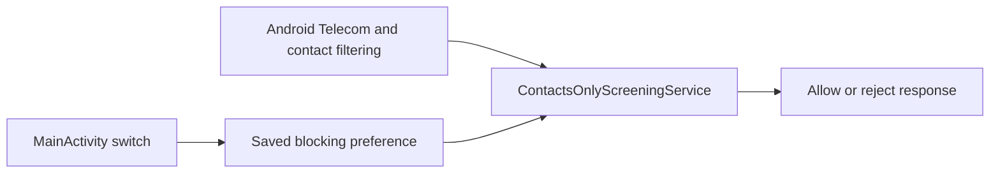

# Architecture and engineering decisions

Contacts Only has three production classes and no runtime library dependencies.

## Android owns the contacts boundary

The app requests the call-screening role. It deliberately does not request
READ_CONTACTS: Android supplies non-contact calls to screening apps without that
permission. Granting contacts access would change the callback population and
invalidate this implementation's assumption. The service accepts outgoing or
unknown-direction events and rejects incoming events only when its saved switch
is on. Its rejected response keeps system history and suppresses notifications.

The service reads the preference for every callback. It does not depend on the
activity remaining open, a timer, an always-running foreground service or cached
UI state. SharedPreferences supplies immediate in-process visibility and saved
state across future launches. The UI displays the combination of the saved
choice and the actual Android role, so losing the role cannot appear active.

## Installation and permissions

Version 1.0 always rejected screened incoming calls. The preference defaults to
on, matching that behavior. Installations need the owner's Android role
approval. Turning the switch off retains the role and allows callbacks;
re-enabling can therefore work without another prompt.

Version 1.2.0 changed the application ID from `com.ben.contactsonly` to
`com.contactsonly.app`; Java classes keep the original namespace. The new ID is
a separate Android app, so nothing carries over from the old one and the
call-screening role moves when the owner approves the new app. Later updates
preserve the new ID and the release signing certificate. Private keys stay
outside Git and fleet source snapshots ([RELEASING.md](RELEASING.md)).
An independently inspected release APK
must have no requested permissions and no debuggable flag. The manifest exposes
the launcher activity and a screening service guarded by BIND_SCREENING_SERVICE.

The app has no network permission, accounts, ads, analytics or message access.
Logs contain a generic rejected-call event, without the caller's number.
Call history belongs to the system; this app does not read it.

## Supported versions

Android 15 (API 35) and later, following the versions Google still updates.
`minSdk` remains 29, so the app installs on Android 10 and later and may work
there, but those versions get no tests, compatibility code or fixes. A change
that needs a newer API raises `minSdk` instead of adding a compatibility path.

## Build inputs

The Gradle wrapper pins the distribution checksum, and
`gradle/verification-metadata.xml` pins the SHA-256 of every Gradle-resolved
dependency, including the Android Gradle Plugin that produces the release APK.
Robolectric downloads its Android runtime jars itself, outside Gradle; those
are test-only and never reach the APK.

## Test boundary

Robolectric checks branching and UI state with controlled Android roles/call
details. Native tests run against an installed APK and actual system roles.
A separate test-only dialer/provider observes Telecom delivery, seeds a synthetic
contact and reads synthetic call history in a disposable emulator. Its permissions
belong to the fixture UID, never to Contacts Only. The fixture is cold-started
before instrumentation, exercising its independent Android class loader.

## Limits

- Android excludes hidden, withheld and other unsupported caller presentations
  from screening callbacks. Phone settings control those separately.
- A spoofed number matching a saved contact can pass Android's contacts filter.
- Android decides what counts as a contact. A caller saved only in a work profile
  or Samsung Secure Folder may be treated as unsaved and rejected; the native run
  records what Android does for a work-profile contact (see TESTING.md), and
  Secure Folder needs a physical Samsung check.
- Other dialer/carrier blocking settings continue to apply when this app is off.
- Incoming carrier behavior and OEM differences need physical-device evidence.
- Text messages stay in the existing messaging app. Becoming a full SMS app is
  outside this product's scope.
- The UI is currently English-only; all of its text is in string resources. Switch accessibility checks do not establish
  a complete TalkBack or assistive-technology qualification.

Platform contract: [Android CallScreeningService](https://developer.android.com/reference/android/telecom/CallScreeningService).
